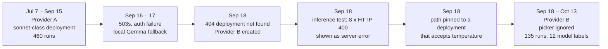

# Proofreading quality review (2026-10-13)

Status: findings and recommendations. Nothing in this document has been implemented yet.
Revision 2 (same day): the routing finding is confirmed by the owner; a new section on the
Settings inference test and on error reporting has been added (section 5.3, Phase 1 of the
roadmap).
Audience: whoever plans the follow-up work on prompts, the LLM layer, evals and UI.

All excerpts from user texts are anonymized. People appear as `<Colleague-A>`, companies and
clients as `<Client>`, and links and tickets as `<URL>` and `<TICKET-1>`. The two corporate
provider entries are called **Provider A** and **Provider B**: both are the same OpenAI-compatible
corporate proxy (`<proxy-host>`), configured as two separate provider rows. Message examples in this document
are synthetic re-creations of the observed patterns; no message text from the logs is included.

---

## 1. Executive summary

From mid-September, proofreading results got visibly worse with "almost any model". The model
dropped greetings ("Hello."), deleted sentences and polite phrases, turned suggestions into
decisions, and sometimes inverted the meaning. The analysis of 645 logged runs points to **four
stacked causes**:

1. **A routing problem made the model picker meaningless (trigger, 2026-09-18, confirmed).**
   Provider B's completion path is stored with a fixed deployment name and no `{deployment}`
   placeholder. `buildCompletionURL` only swaps the selected model into that placeholder, so
   every request went to one small, haiku-class deployment, whatever model the user picked.
   Several things show this:
   - "Different" models returned byte-identical text.
   - Every label, including the "reasoning" models, answered in 1–3 s.
   - All labels behave the same way.
   - Quality changed in a single step on the day of the switch, not gradually.

   The owner has since confirmed it: changing the deployment restored the quality.
2. **The Settings inference test pushed the owner into that configuration.** The test does not
   send a bare request. It sends the saved temperature, max-token and context settings
   (`internal/verification/service.go:178-250`). Newer models reject `temperature` with HTTP 400,
   and the app reports every 400 as "*Provider had a server error (400). Please retry.*". It also
   throws away the provider's explanation and marks the error as retryable. On Sep 18 the test
   failed 8 times in a row this way. The message pointed at the deployment rather than the
   rejected parameter, so the owner changed the deployment, and the pinned path made the picker
   meaningless.
3. **The prompt itself permits the damage.** 92% of runs used one user stack, proofread
   "enhanced" plus "humanize", and both steps are merged into a single LLM call. Several phrases
   in it directly license deletion and restructuring:
   - humanize: "remove … corporate filler", "deliberately vary sentence and paragraph length",
     "prefer active voice";
   - enhanced: "remove unnecessary redundancy" and "resolve ambiguous references".

   A strong model mostly ignored these licences. The weaker backend applied them literally. A
   control run with proofread "enhanced" alone kept everything. **This is the part that must be
   fixed even though the routing is repaired.** The prompts have to produce faithful output on
   small and weaker models, including local Gemma 4 E4B, rather than relying on a strong model
   to ignore bad instructions.
4. **Nothing measures or guards the result.** Specifically:
   - Temperature is 0.9.
   - Local models run with hidden "thinking" turned on, at 40–60 s per short message.
   - No output is checked against its input.
   - There are no evals.
   - The task log records the model the user picked, not the model that actually answered.

A probe of the local models (section 8) supports this. Under today's prompt, Gemma 4 E4B dropped
the greeting in 3 to 4 of 8 cases and removed hedges in 4 to 6 of 14. Under a draft dedicated
proofreading prompt it kept the greeting in 8 of 8 cases and lost no hedges, and E4B, 26B and
gpt-oss all showed the same pattern.

The same evidence answers the "make the text more human" question. The app's outputs rarely
contain classic "AI slop" words: words like *delve* and *tapestry* appear 0 times in 645 runs. The
AI-like signal comes from things the model **adds**:
- em dashes (16% of runs overall, 40% after the routing change);
- contractions (74% of runs);
- "However" and "ensure";
- colon fragments and rhetorical fragments.

The model also **strips the author's own voice**: "So," openers, hedges and "please". The right rule
for every action is therefore **"introduce no new AI-tells and keep the author's voice"**. A general
"humanize the text" rewrite is the wrong tool.

**Top recommendations, in order:**
1. Configuration fixes, no code:
   - Use `{deployment}` in Provider B's completion path.
   - Set temperature to about 0.2.
   - Remove humanize from the everyday stack.
2. Make the Settings inference test send a **bare request** (model plus one user message, no
   optional parameters). Then test the saved parameters separately and name the one that is
   rejected. Report HTTP 4xx errors honestly: say it is a request error, not a server error;
   show the provider's own message, sanitized; and do not retry it.
3. Log which model actually answered, the finish reason and a prompt version, and warn when a
   pinned completion path ignores the model picker.
4. Build a small eval harness on the real Planner and Composer, and measure a baseline before
   changing any prompt.
5. Add a dedicated, short proofreading system prompt. It lists what to **fix**, what to **keep**,
   and a shared "house style" with no new tells. Remove the em dashes from the app's own prompts.
6. Add diff-based guards that flag dropped greetings or sentences, lost hedges and newly
   introduced tells. Make the diff view the default for proofreading.

---

## 2. Dataset and method

| Source | Content |
|---|---|
| Task logs `tasks-*.jsonl` (54 files, 2026-07-07 → 2026-10-13; local copy in the git-ignored `.tmp/GoTextApp/logs/`) | 645 runs, each with input, output, full system and user prompt, provider, model label, duration |
| `app.log` (zerolog, trace level) | ~5,900 lines: errors, retries, provider edits |
| `gotext.db` (opened read-only) | settings, providers, stacks, history |

**Action mix:**
- `rewrite.proofread.enhanced+rewrite.intent.humanize` (the user stack "Everyday"): 595 runs, 92%.
- `translate.text` (English → Ukrainian): 41 runs.
- Other actions: 9 runs (professionalize, tone, email structure, consistency).

**Prompt stability.** For the main stack, the system prompt is a single, identical text in all 595
runs. The user prompt template differs only in the `Format:` line. The v3 catalog was added in one
commit (`0e36bfc`, 2026-07-07), and no later commit changed it.

**Heuristics.** All metrics compare each run's input with its output.
- **Edit ratio:** 1 − `difflib.SequenceMatcher` ratio over lower-cased word tokens.
- **Length ratio:** output words divided by input words.
- **Greeting dropped:** the input starts with `hello|hi|hey|dear|good morning…` and the output does not.
- **Fewer sentences:** fewer sentences in the output, splitting on `[.!?]` followed by whitespace, or
  on a newline.
- **Line-break loss:** fewer newlines in the output, counted only for multi-line inputs.
- **Marker lost:** a marker family (please, could/can you, maybe/perhaps, try to, seems,
  I think/believe/suppose, would like) occurs fewer times in the output than in the input.
- **Tell introduced:** the pattern occurs more times in the output than in the input. Section 8
  lists the patterns.
- **Retry cluster:** consecutive runs no more than 180 min apart where the inputs have a character
  similarity of at least 0.6, or where the previous output was pasted back with edits.

Unless a table says "raw", numbers are deduplicated: identical inputs sent to the same provider
are counted once.

**Typical input:**
- **Length and format.** Median 63 words (p90: 188). 65% contain line breaks.
- **Genre.** Work chat messages: status updates, deployment coordination, access problems, a few
  emails and ticket comments.
- **Content features.** 28% start with a greeting, 18% contain lists, 14% contain URLs and 11%
  contain ticket IDs.
- **Errors.** These are typical of non-native writing:
  - articles: "the" inserted 433 times and removed 592 times across outputs;
  - future tense in "when/if" clauses;
  - prepositions;
  - word order ("I also yesterday was asking");
  - dropped subjects;
  - " - " used to join clauses (in 64% of inputs);
  - typos.
- **Voice.** The author relies on softeners ("Just would like to…", "maybe", "I suppose",
  "for me it looks", "please"). These carry meaning: they mark a suggestion as a suggestion.

---

## 3. Timeline and the routing finding


*Caption: the quality change lines up with the provider switch, not with a prompt or app change.
The misleading inference-test error is what led to the pinned path.*

**What happened** (from `app.log`):
- **Sep 16:** seven runs failed with HTTP 503 after 3 retries each.
- **Sep 17:** authentication failed on Provider A, and the user switched to local
  `gemma4:e4b` (37–60 s per run).
- **Sep 18:** the Provider A deployments returned 404 "deployment not found".
- **Sep 18, 10:15–10:25:** the Settings inference test against the new model failed with HTTP 400
  **8 times**. Each time the app showed "*Provider had a server error (400). Please retry.*" The
  provider's response body, which most likely named the rejected parameter (`temperature`), was
  discarded (`internal/llms/http_errors.go:51-56`).
- **Sep 18, 10:47:** two chain runs got the same 400, and each was **retried 3 times** with backoff
  before failing, because `apperr.Upstream` marks every non-mapped status as retryable
  (`internal/apperr/apperr.go:195-207`).
- **Sep 18, 10:48:** after a second provider edit, the stored completion path names one specific
  haiku-class deployment that accepts `temperature`, and the first run succeeded in 792 ms. From
  here on, the model picker had no effect.

**Why the picker stopped working.** `internal/llms/openai_provider.go:36-44`:

```go
tmpl = strings.ReplaceAll(tmpl, "{deployment}", p.cfg.Config.SelectedModel)
return base + strings.TrimPrefix(tmpl, "/")
```

A path without `{deployment}` is used as is. The request body still sends `"model": req.Model`
(`openai_provider.go:108`), but Azure-style proxies route by the URL. The task log's model field
holds the configured label, not the served model. `chatOnce` returns only `resp.Content`
(`internal/llms/service.go:259`), so the response's `model` field is never seen.

**Evidence that one model answered everything after Sep 18:**
- Byte-identical outputs from runs labelled "opus-5", "gpt-4o" and "gpt-5" on the same input
  within 2 minutes.
- Byte-identical outputs from runs labelled "gpt-4.1" and "gpt-5.1-reasoning".
- Every label, including "reasoning" models, answered in 1–3 s, at about 28 ms per output word.
  The previous sonnet-class deployment needed 55 ms per word.
- All 12 labels share one behaviour profile (section 6).

**Status: confirmed.** The owner changed the deployment afterwards and the quality came back.
Served-model logging (Phase 1) would have made this visible in the first day.

**Era comparison.** Same prompt and same kind of input.

| Metric | Era A (Provider A) | Era B (Provider B) |
|---|---|---|
| Greeting dropped (dedup) | **0 / 123** | **8 / 35** (raw: 11 / 44) |
| Output has fewer sentences | 5% | 21% |
| Heavy rewrite (edit ratio > 0.5) | 7% | 22% |
| Minimal edits (edit ratio < 0.2) | 26% | 8% |
| Line breaks merged (multi-line inputs) | 12% | 30% |
| "please" reduced (inputs containing it, dedup) | 23% | 100% (8 / 8) |
| Em dash introduced | 9.8% | 39.7% |
| Runs that were retries of a previous run | 3.5% | 18% |

The gap is present in every input-length bucket (fewer than 30, 30–59, 60–119 and 120 or more
words). Genre mix is stable between the eras. Era A is flat across July, August and early
September. Neither length, genre nor calendar drift explains the change.

---

## 4. Failure taxonomy

Counts are for era A vs era B, deduplicated. Examples are anonymized and shortened.

| # | Failure | A | B | Example (input → output) |
|---|---|---|---|---|
| 1 | Greeting dropped | 0/123 | 8/35 | "Hello. I will send it tomorrow. Today I was in workshops all day, so tomorrow I will send the summary." → "I was in workshops all day, so I'll send the summary tomorrow." |
| 2 | Acknowledgement or courtesy sentence dropped | ~6% | ~31% | "Ok, understood. Thanks for clarification. Then I will confirm with `<Colleague-A>`…" → "I'll confirm with `<Colleague-A>`…" |
| 3 | "please" / "could you" request reworded away | 23% / 30% | 100% / 91% | "Please, help to unblock the import" → "Can you help unblock the import?"; "could you please advise how to proceed if…" → "How should I proceed if…" |
| 4 | Hedge removed (maybe, I think, try to, seems) | 15–43% per marker | 45–83% per marker | "Seems the job is not scheduled on `<Client>`…" → "The job isn't scheduled on `<Client>`…" |
| 5 | Suggestion turned into a decision or fact | present | more frequent | "I would postpone the upgrade" → "I'll postpone the upgrade"; "theoretically we can add cache" → "we can add a cache" |
| 6 | Meaning inverted or agent changed | ~5 found | ≥7 found | "I suppose we simply miss this alert" (meaning *missed*) → "I think we should ignore this alert"; "we can merge it when we will be ready" → "…whenever you're ready"; "`<Colleague-B>` is on the your question" → "`<Colleague-B>` is your question" |
| 7 | Ambiguity "resolved" wrongly | present | present | "link the RFCs to the epic" (RFC = request for change) → "link the Requests for Comments…" |
| 8 | Framing sentence dropped | present | more frequent | "Just to clarify what I meant." (first sentence) dropped entirely |
| 9 | Sentences or lines merged | 5% / 12% | 21% / 30% | short chat lines joined into one paragraph |
| 10 | Register shifted to casual or rhetorical | systematic | stronger | contractions added in 303/595 runs; "What's your take?", "I'd love to know what you think", "The result?" |
| 11 | Em dash introduced | 9.8% | 39.7% | "Maybe you are right - the rule is not needed" → "Maybe you're right—the rule isn't needed" |
| 12 | Facts, URLs, IDs, numbers lost | 0 | 0 | preserved (only "6" → "six" style changes) |
| 13 | Preamble, code fences, wrong language, truncation, `<think>` leak | 0 | 0 | output discipline is fine |

**Retry clusters.** These show what the user was unhappy with.
- **Era A:** 14 chains with 16 retry runs, and no identical re-runs. The user fixed the *input* to
  steer the model. Examples:
  - adding "propose to" so that "I would postpone" was not turned into "I'll postpone";
  - spelling out an abbreviation;
  - rewriting a "maybe …" sentence that the model had read as a causal claim.
- **Era B:** 14 chains with 25 retry runs, 15 of them byte-identical re-runs. Switching models in
  the picker became the main tactic, which could not help if the picker was ignored. Examples:
  - one input sent under 4 labels: all 4 dropped "Hello.";
  - 6 identical re-runs under one label returned 6 byte-identical outputs that dropped the "could you
    please" request. A proofread-only run of the same text, a minute later, kept everything;
  - one identical re-run 9 s after the first restored a sentence the first run had dropped. At
    temperature 0.9, this is variance.

---

## 5. Root causes in the prompts and code

### 5.1 Prompt phrases mapped to failures

The main stack sends `SysRewrite` (`internal/prompts/v3/system.go:5-23`) plus this user prompt,
built by `Composer.rewriteUserPrompt` (`internal/actions/composer.go:101-115`):

```
Apply the following edits to the text in order:
1) <rewrite.proofread.enhanced directive>      (catalog.go:41)
2) <rewrite.intent.humanize directive>         (catalog.go:128)
<<<UserText Start>>> … <<<UserText End>>>
Format: PlainText
Reminder: reply with only the requested result text. …
```

| Phrase | Where | Failures it licenses |
|---|---|---|
| "remove formulaic AI-tell vocabulary and **corporate filler**" | humanize | greetings, "Ok, got it", "Thanks", "please", "could you", "Just wanted to…" treated as filler (failures 1–3) |
| "**deliberately vary sentence and paragraph length** so the rhythm is uneven" | humanize | merged and split sentences and lines, rhetorical fragments (9, 10) |
| "**prefer plain verbs and active voice**" | humanize | agent changes, conditionals becoming decisions (5, 6) |
| "Make the text read as **natural human writing**" | humanize | contractions, casual idioms; conflicts with step 1's "without changing … register" (10) |
| "**remove unnecessary redundancy**", "**smooth sentence flow and transitions**" | enhanced | framing sentences deleted, sentences merged (8, 9) |
| "**resolve ambiguous references**" | enhanced | the model commits to one reading of unclear non-native phrasing (6, 7) |
| Rule 6 "…unless a directive explicitly requires it" and "Keep… length close… unless a directive inherently requires a change" | `SysRewrite` | let humanize override "keep structure" |
| No list of what to keep (greetings, hedges, politeness, who does what) | `SysRewrite` | nothing positively protects what the user cares about |

**Control evidence.** On Sep 22, the same text was run six times through the merged stack. All six
outputs dropped the polite request ("could you please …") and the check question ("do I
understand correctly …"). A run with proofread "enhanced" alone, a minute later, kept the
greeting, the polite request and the check question. **The humanize step is the main damage driver.**

**v2 → v3 regression.** The v2 "enhanced" proofread said "Remove unnecessary redundancy *while
preserving all original information*". The v2 system prompt also said "Never remove meaning" and
"Preserve original formatting, structure, and line breaks". v3 shortened this and lost those
protections. Humanize did not exist in v2.

### 5.2 Pipeline and settings

| Finding | Location | Effect |
|---|---|---|
| All mergeable `rewrite.*` steps become one LLM call | `internal/actions/planner.go:155` (`mergeGroups`) | conflicting directives (minimal fix vs "vary rhythm") are resolved by the model, and the broadest instruction tends to win |
| One shared `SysRewrite` for 45 actions (proofread, intent, 20 tones, 15 styles) | `internal/actions/composer.go:51-80`, `system.go:5` | proofreading inherits a rewriting-oriented system prompt |
| Temperature 0.9 in the user DB (seed default 0.5) | `internal/db/db.go:366` | run-to-run variance on a faithfulness task |
| No `think`, reasoning effort, top_p or seed sent | `internal/llms/llms.go`, `ollama_native.go` | local thinking models think at full length (section 7); no control for gpt-oss |
| Temperature sent to reasoning models when `useTemperature` is on | `internal/actions/service.go` (`newChatCompletionRequest`) | can be rejected by newer reasoning models |
| Served model, finish reason and usage dropped | `internal/llms/service.go:259` | truncation is invisible, and routing problems cannot be seen in logs |
| `[NO_TEXT_PROVIDED]` and `[PROCESSING_ERROR]` exist only in prompts | `system.go` | never detected, recorded as success |
| No output validation and no evals; tests are structural only | `internal/prompts/v3/catalog_test.go`, `internal/actions/composer_test.go` | prompt changes cannot be judged before release |
| `Format: PlainText` is sent even for list-heavy inputs | `composer.go` | appears harmless in the logs; noted only |

### 5.3 Settings inference test and error reporting

This explains why the owner ended up with a pinned deployment path. The cause is a chain of three
small design choices.

**1. The inference test is not a minimal request.** `TestInference`
(`internal/verification/service.go:178-250`) builds the request from the saved global
`ModelConfig`:
- `temperature`, when `useTemperature` is on (it was 0.9);
- `max_completion_tokens` or `max_tokens`, when `useMaxOutputTokens` is on (it was 32000);
- `num_ctx`, when `useContextWindow` is on (it was 128000).

The code comment says this is deliberate: "so this diagnostic exercises the same parameters as
production traffic, not an unconstrained bare prompt". As a result, the test cannot tell "the
model or deployment is wrong" apart from "the model rejects one of my optional parameters".

Several facts make this worse:
- `ModelConfig` is one global setting. It is not stored per provider or per model, so switching to
  a newer model keeps a `temperature` that model rejects.
- `max_completion_tokens: 32000` can also exceed a model's output limit, which is another source of
  400s.
- The OpenAI wire request always includes `n: 1` (`internal/llms/openai_provider.go:107-112`).
  Some proxies and model families reject that too.

**2. Every HTTP 400 is reported as a retryable server error.** `mapHTTPStatus`
(`internal/llms/http_errors.go:39-60`) special-cases 401/403, 404, 429 and the context-overflow 400.
Every other status, including 400 and 422, becomes `apperr.Upstream`
(`internal/apperr/apperr.go:195-207`), which:
- is titled "Provider error", with the message "*<provider> had a server error (<status>). Please
  retry.*" A 400 is a request error, not a server error, and retrying cannot fix it;
- sets `Retryable: true`, so chain runs retry a deterministic 400 three times with backoff. On
  Sep 18 that meant 2 runs × 4 attempts, about 5 s wasted each;
- passes `cause: nil` and discards the response body. Whatever the provider explained ("Unsupported
  parameter: 'temperature'…") is never logged or shown. It is not even in `app.log`.

**3. The UI shows only the message string.** `testProviderInference`
(`frontend/src/logic/store/settings/thunks.ts:513-524`) rejects with `err.message` only.
`VerificationPanel` shows that string. The status code in `Details` never reaches the user.

**Existing partial protection.** `ModelConfigTab` turns the temperature toggle off when model
discovery reports `supportsTemperature: false`
(`frontend/src/ui/widgets/views/settings/tabs/ModelConfigTab.tsx:100,118`). Only discovery
responses that carry Azure-style `features` fill that capability (`internal/llms/discovery.go:81`).
Provider B uses a plain `openai/models` listing, so the protection never fired.

**What the owner saw:** "server error, please retry" eight times. The fix that "worked" was pinning
a deployment that happened to accept temperature, and that pin silently disabled the model picker.

**Required behaviour:**

| # | Requirement | Where |
|---|---|---|
| R1 | The inference test sends a **bare request**: `model`, one short user message, `stream: false`. No temperature, no token limit, no `num_ctx`, no `n`. | `verification/service.go` `TestInference`; Ollama native: only `model`, `messages`, `stream` |
| R2 | If the bare request succeeds, run a second check "**with your model settings**". If that fails with a 4xx, find which optional parameter is rejected: retry once without each enabled parameter, in the order temperature, token limit, context window, at most 3 extra calls. Report it, e.g. "*The model works, but it rejects `temperature`. Turn off Temperature in Model settings.*" | `TestInference`; `VerifyOutcome` gains `rejectedParam` and `hint` fields (bindings regenerate) |
| R3 | Map HTTP 4xx precisely. 400 and 422 get a new non-retryable code (e.g. `invalid_request`), titled "Request rejected", with the message "*<provider> rejected the request (400): <provider message>*". Only 5xx stays `upstream` ("server error", retryable). | `internal/llms/http_errors.go`, `internal/apperr/apperr.go` (new code plus `EnumBind` in `main.go`) |
| R4 | Extract the provider's own error text from the common body shapes: OpenAI/Azure `{"error":{"message","param","code"}}`, Anthropic `{"error":{"type","message"}}`, Ollama `{"error":"…"}`. Fall back to plain text. Put a **sanitized excerpt** (about 300 chars max, with anything that looks like a key, bearer token or URL query removed) and the `param` in `Details`, and log the full sanitized body once at the handler boundary. | `http_errors.go` (a new body parser), following the existing `isContextExceededBody` pattern |
| R5 | Recognize known "unsupported parameter" bodies (`unsupported_parameter`, `unsupported_value`, "temperature … not supported", "Only the default (1) value is supported", "max_tokens is not supported … use max_completion_tokens") and turn them into a specific hint, so the chain error says which setting to change. | `http_errors.go` |
| R6 | The frontend shows the title, message and hint, plus a collapsible "Provider said: …" line, for the test and for chain errors. It keeps the whole `WireError`, not only `message`. | `settings/thunks.ts`, `VerificationPanel.tsx`, `NotificationContainer` |
| R7 | Optional and later: remember a learned capability ("model X rejects temperature") per provider and model in the settings KV, and skip that parameter automatically, with a visible note. | `internal/settings` KV, `newChatCompletionRequest` |

R1–R6 are Phase 1 items. Each needs tests: table-driven `mapHTTPStatus` cases built from real
body samples, and a `TestInference` test with an `httptest` server that rejects `temperature`.

---

## 6. Per-model and era comparison

Deduplicated. A sample size (n) under 5 is anecdotal. Era B labels are what the user *picked*,
which is probably not what answered (section 3).

| Provider / label | n | Edit ratio median | Edit ratio > 0.5 | Greeting dropped | Fewer sentences | Em dash added |
|---|---|---|---|---|---|---|
| A: sonnet-class, Jul | 133 | 0.30 | 8% | 0/41 | 8% | 11% |
| A: sonnet-class, Aug | 289 | 0.29 | 7% | 0/74 | 4% | 9% |
| A: sonnet-class, Sep | 38 | 0.30 | 5% | 0/8 | 11% | 5% |
| **A total** | 460 | 0.29 | 7% | **0/123** | 5% | 10% |
| **B total** | 116 | 0.40 | 22% | **8/35** | 21% | 36% |
| B: "claude-sonnet-5 (websearch)" | 40 | 0.42 | 18% | 1/13 | 20% | 42% |
| B: "gpt-5.6" | 34 | 0.41 | 24% | 4/10 | 18% | 26% |
| B: "opus-5" | 13 | 0.33 | 23% | 1/4 | 8% | 31% |
| B: "gpt-6" | 11 | 0.33 | 9% | 0/2 | 45% | 27% |
| B: "haiku-4-5" | 9 | 0.40 | 22% | 0/2 | 0% | 44% |
| Local gemma4:e4b (Sep 17) | 3 | 0.38 | 0% | 0/3 | 33% | 0% |

The B labels are nearly indistinguishable from one another, as they would be if one deployment
answered all of them.

---

## 7. What works well

- **Facts and artefacts.** URLs, ticket IDs, version strings, numbers, code blocks and list
  structure were preserved in effectively every run. List items were dropped in only 4 of 106
  list inputs.
- **Output discipline.** There were zero preambles, code fences, delimiter leaks, edge-case
  markers, `<think>` leaks or language switches. The guardrail suffix and delimiters work.
- **Minimal edits on strong models.** 26% of era A runs had an edit ratio below 0.2, with correct
  fixes to articles, tense, prepositions and typos. Examples (synthetic, same shape): "nobody
  have objections" → "nobody has objections"; "I need an access again for this: `<URL>`" → "I need
  access again for this: `<URL>`".
- **Long and technical texts.** These are edited more conservatively than short conversational
  ones.
- **Translation (EN → UK).** 41 runs, clean. Structure was kept and the dash use is correct for
  Ukrainian. One "please" was dropped, and one product name was read as a common noun.
- **The worst case is the core use case.** Messages of 30–60 words that are mostly politeness and
  stance ("Just checking…", "Ok, understood…", "Just to clarify, do I understand correctly…") had a
  median edit ratio of 0.44 in era B.

---

## 8. Local-model specifics

Targets: Gemma 4 E4B (Q4), Gemma 4 26B (Q4), GPT-OSS 20B (MXFP4), through Ollama and LM Studio.

**Thinking is on by default and dominates latency.** The app sends no `think` field to Ollama's
native `/api/chat` (`internal/llms/ollama_native.go`).
- `gemma4:e4b` produced about 3–4k characters of hidden reasoning, at 42–48 s per call for a
  40-word message.
- `gpt-oss:20b` took 45–64 s.
- The production Ollama runs on Sep 17 took 37–60 s.
- With `think: false`, the calls in the probe below took 2–9 s. One earlier single run that included
  loading the model took 13 s. With `think: "low"`, gpt-oss produced about
  0.5k characters of reasoning.

**Sampling guidance from vendors.**
- **Gemma 4:** supports the `system` role. Thinking is enabled by a `<|think|>` token in the system
  prompt. The 26B variant may emit an empty thought channel. The official default is
  `temperature 1.0, top_p 0.95, top_k 64`. Low temperatures for editing are untested in vendor
  docs and need an eval.
- **GPT-OSS:** uses the harmony format. The app's "system prompt" belongs in the *developer*
  message, and reasoning effort can be low, medium or high (default medium). Ollama `/v1` accepts
  `reasoning_effort`. LM Studio returns reasoning in a separate field.
- **Context:** Ollama silently truncates the oldest tokens when the context overflows, and the
  system prompt comes first. Prompts must stay short, and `usage.prompt_tokens` should be logged.

**Directional probe.** 14 log cases × 3 models × 3 variants were run with thinking off, so the
results show a direction, not a measurement:
- "current@0.9" and "current@0.2": today's production prompt at temperature 0.9 and 0.2;
- "draft@0.2": a draft dedicated proofreading prompt (section 12.1) at temperature 0.2.

| Model | Variant | n | Greeting kept | Fewer sentences | Line breaks lost | "please" lost | Hedge lost | Em dash added | Contraction added | Word similarity (median) | Latency s (median) |
|---|---|---|---|---|---|---|---|---|---|---|---|
| gemma4:26b-mlx | draft@0.2 | 14 | 8/8 | 1 | 2/9 | 0 | 0 | 1 | 0 | 0.83 | 3 |
| gemma4:26b-mlx | current@0.2 | 14 | 8/8 | 2 | 4/9 | 0 | 5 | 3 | 5 | 0.57 | 2 |
| gemma4:26b-mlx | current@0.9 | 14 | 8/8 | 2 | 5/9 | 0 | 4 | 3 | 7 | 0.57 | 3 |
| gemma4:e4b-mxfp8 | draft@0.2 | 14 | 8/8 | 1 | 2/9 | 0 | 0 | 1 | 0 | 0.87 | 2 |
| gemma4:e4b-mxfp8 | current@0.2 | 14 | 4/8 | 4 | 6/9 | 0 | 4 | 3 | 3 | 0.56 | 2 |
| gemma4:e4b-mxfp8 | current@0.9 | 14 | 5/8 | 2 | 8/9 | 0 | 6 | 1 | 2 | 0.54 | 2 |
| gpt-oss:20b | draft@0.2 | 14 | 8/8 | 1 | 7/9 | 0 | 0 | 1 | 1 | 0.90 | 9 |
| gpt-oss:20b | current@0.2 | 14 | 7/8 | 3 | 8/9 | 0 | 7 | 3 | 3 | 0.53 | 7 |
| gpt-oss:20b | current@0.9 | 14 | 5/8 | 3 | 8/9 | 0 | 7 | 4 | 2 | 0.51 | 7 |

Cases: 14 logged inputs, 8 of them starting with a greeting and 9 multi-line. Thinking was off: `think:false` for Gemma, `think:"low"` for gpt-oss. One sample per cell, so the counts are directional. "Hedge lost" counts maybe, perhaps, I think/believe/suppose, seems, would, try to and just.

How to read the table:
- **The current prompt reproduces the production failures on every local model:**
  - E4B dropped the greeting in 3 or 4 of 8 cases, and gpt-oss in 1 to 3 of 8;
  - line breaks were lost in most multi-line cases;
  - hedges were removed in 4 to 7 of 14 cases;
  - em dashes and contractions were introduced.
- **Lowering the temperature from 0.9 to 0.2 helps very little.** Similarity stays at 0.51 to 0.60, so the instructions, not sampling, drive the damage.
- **The draft prompt is faithful on all three models:**
  - greetings kept in 8 of 8 cases;
  - no hedges lost;
  - at most 1 em dash or contraction introduced;
  - word similarity of 0.83 to 0.90.
- **Typical draft outputs are minimal and correct.** Examples (synthetic, same shape): "I am seeing warning that it needs reviewer" became "I am seeing a warning that it needs a reviewer"; "no blockers - you can merge" became "no blockers, you can merge".
- **gpt-oss still loses line breaks under the draft (7 of 9).** It re-flows lines, and in one case split one paragraph into lines with trailing spaces. Line-break preservation needs a stronger instruction for gpt-oss or a guard, and should be measured in the eval.
- **The draft leaves some unidiomatic but understandable wording unchanged**, for example "for me it looks like". Whether that counts as under-correction or as keeping the author's voice should be settled with seeded-error cases.
- **With thinking off, latency fell from 42 to 64 s to 2 to 9 s per call.** This alone makes local models usable for this app.

Earlier, with thinking on (6 cases on gemma4:e4b):
- The current prompt merged line breaks in 5 of 6 cases at both 0.9 and 0.2 (word similarity
  0.53–0.60).
- A short keep-list prompt kept lines, greetings and "please" (similarity 0.81).

A second reviewer's runs confirmed the damage on gpt-oss under the current prompt: a hedged
opinion sentence ("I think we simply miss …") was deleted, and a short "Please check." request
became "Let me know if that's the case."

**Important caveat.** A keep-list-only prompt **under-corrects**. It left errors such as
"in any time", "Everything else - works fine" and "a an update" unchanged. The prompt must also say
explicitly what to fix (section 12.1).

---

## 9. Human-like output across all actions

### 9.1 What the app actually adds and strips

Measured on the 595 main-stack runs. A tell is "introduced" when it occurs more times in the output
than in the input.

| Tell | Runs introducing it | Notes |
|---|---|---|
| Any tell | 23% (A 17%, B 44%) | rises with length: 0% under 20 words, 49% at 200 words or more |
| Em dash `—` | 16.3% (A 9.8%, B 39.7%) | 63 of 97 cases convert the author's " - " into an unspaced "word—word" |
| Contractions | 74% | uncontracted forms dropped from 1,379 to 115 |
| Colon-led fragments ("The key point:") | 24 runs | |
| "However" | 16 runs | |
| "ensure" | 7 runs | |
| Rhetorical fragments ("The result?", "What can go wrong?") | ~4 runs | |
| Oxford-comma triplets | ~34 runs (noisy) | |
| Classic slop words (delve, tapestry, leverage, landscape, testament, robust, seamless…) | **0 in inputs, 0 in outputs** | humanize's own example list never applies to this user |

**Author voice markers the app removes:**

| Marker | Inputs → outputs |
|---|---|
| "So," at sentence start | 218 → 10 |
| " - " used to join clauses | 1,277 → 494 |
| "And"/"But" sentence openers | removed in 91 runs |
| "Basically"/"Anyway" openers | removed in 61 runs |

**Other actions.**
- `rewrite.intent.professionalize` and `rewrite.tone.professional` add corporate vocabulary
  ("ensure", "facilitate", "strategic", "alignment", "Dear Team", "I am writing to inform you").
- `structure.doc.email` adds "Subject:" and "Best regards", which fits the format.
- Translation is clean.

**The prompts model the tell.** 22 of 91 directives in `internal/prompts/v3/catalog.go` contain
em dashes, about 19 per 1,000 words. Every tone directive uses the pattern
"Adjust the tone to be X — A, B, and C — …", an em dash plus a rule-of-three triplet
(e.g. `catalog.go:155`). `system.go` also contains many. The em-dash rate changed with the
backend while the prompt stayed the same, so the backend is the larger factor. But the prompts
demonstrate the very pattern the app should avoid.

### 9.2 What the requested sources say

**deslop-text** (github.com/adamdunkels/deslop-text, MIT).
- A prompt-only Claude skill with 32 checks (W1–W32) in three severity levels, a review mode and a
  fix mode, and a 22-text regression corpus.
- **Reusable:** its word lists, its numeric thresholds (more than 1 em-dash aside per paragraph or
  more than 3 per document; more than 1 rhetorical question per 500 words), and its rule "every
  rewrite must preserve the original meaning".
- **Unsafe for proofreading:**
  - W26 forces contractions;
  - W29 "vary sentence length", the same instruction that caused our merges;
  - W8 "commit or cut" hedges;
  - W7 passive → active, which can flip who does what.

**Wikipedia: Signs of AI writing.**
- **Taxonomy:**
  - content: undue significance ("stands as a testament", "pivotal role"), trailing
    ", highlighting/ensuring…" clauses, promotional words, vague attributions, formula conclusions;
  - language: an AI vocabulary that changes with each model generation; avoiding plain "is"
    ("serves as", "stands as"); negative parallelism ("not X, but Y"; "It's not X, it's Y");
    rule of three;
  - style: title-case headings, too much bold, emoji as bullets, curly quotes;
  - assistant chatter: "I hope this helps", "Certainly!", "Would you like…".
- **Two points that matter most here:**
  1. It lists hedges, plain "is/has" phrasing and wordy qualifiers as signs of *human* writing.
     Removing hedges makes text look *more* machine-written.
  2. The em dash is now a dated tell. The newest models are tuned to avoid it and overuse commas
     instead, which is starting to be seen as a tell in its own right.

**Reddit thread** "What are the most obvious signs of AI writing?". The top comments name:
- polished, fake-friendly corporate tone ("three rounds of HR approval");
- "it's not X, it's Y";
- a closing offer or question;
- triplets, random bold, bullets and emoji;
- fragment questions ("Honestly?").

Many commenters are humans who get falsely accused because they use em dashes or semicolons.

**Further research:**
- Positive instructions work better than ban lists (Anthropic prompting guide).
- Telling a model to avoid a word can make that word *more* likely, the "pink elephant" and
  "white bear" effects (arXiv 2402.07896, 2511.12381). Small models are the most exposed, so long
  "never say" lists are risky for E4B.
- Instruction-tuned models use present-participle clauses at 2–5× the human rate (PNAS 2025).
- AI detectors flag non-native writers: more than half of TOEFL essays were labelled AI
  (arXiv 2304.02819). **Chasing detectors is the wrong goal** for this app's users.
- `logit_bias` is not available on Ollama `/v1`. In llama.cpp and LM Studio it acts on subword
  tokens, so banning a string bans unrelated words. Repetition and frequency penalties push the
  model into synonym swaps, which is bad for proofreading and translation.

### 9.3 Tiered AI-tell catalog

**Tier 1: never introduce.** These can be checked deterministically, after case-folding and
NFKC normalization.
- **Punctuation and format:**
  - `—` (U+2014), and a spaced en dash ` – ` used as a dash;
  - curly quotes when the source used straight ones;
  - `…`;
  - emoji;
  - two or more `#hashtags`;
  - markdown (`**`, `#`, `- `, `1. `) in plain-text output;
  - placeholders such as `[Your Name]` or `XX-XX`.
- **Assistant chatter:**
  - "Certainly!", "Of course!", "Absolutely!";
  - "Great question", "You're absolutely right";
  - "I hope this helps";
  - "Here is/Here's the (revised|corrected|rewritten) …";
  - "Would you like …", "Is there anything else";
  - "Let me know if you have any (other) questions", "Feel free to reach out";
  - "as an AI (language model)", "as of my last update";
  - "based on (the) available information".
- **Openers and closers:**
  - "I hope this (message|email) finds you well";
  - "In today's (fast-paced|digital) world";
  - "(We're|I'm) (excited|thrilled) to (announce|share)";
  - sentence-initial "In conclusion," / "In summary," / "Overall,";
  - "What's your take?", "I'd love to (hear|know) what you think";
  - "The result?", "Honestly?".
- **Vocabulary:**
  - delve, tapestry, testament, intricate, meticulous, pivotal, underscore, showcase;
  - bolster, garner, interplay, vibrant, boasts, crucial, foster, multifaceted, realm, nestled;
  - seamless, leverage (as a verb), utilize, robust, holistic, cutting-edge, game-changer;
  - transformative, groundbreaking, best-in-class, synergy, paradigm shift.
- **Phrases:**
  - "it's worth noting", "it's (important|crucial) to note";
  - "at the end of the day", "moving forward";
  - "stands as a testament", "(plays|played) a (pivotal|crucial|key) role", "serves as a";
  - "evolving landscape", "deeply rooted", "setting the stage for";
  - "here's the thing", "let that sink in";
  - "deep dive", "circle back", "move the needle", "touch base";
  - "experts say", "studies show".

**Tier 2: structural.** Describe these in prompts. Checks for them are heuristic.
- negative parallelism (`not … but`, "it's not X, it's Y", "not just … but also");
- trailing ", highlighting/underscoring/ensuring/reflecting/fostering…" clauses;
- "serves as / stands as" used in place of "is";
- abstract triplets;
- rhetorical fragment questions;
- colon-led fragments;
- engagement-bait closers;
- section-end summaries;
- formatting nobody asked for (bullets, bold, title-case headings);
- praise and sycophancy;
- puffing up significance;
- new transition words (However, Additionally, That said);
- formality creep (ensure, regarding, facilitate).

**Tier 3: context-dependent.** The source and the target tone decide these, never a "humanize"
rule:
- contractions;
- exclamation marks;
- hedges;
- passive voice;
- sentence length;
- formality.

### 9.4 Principle and per-family application

Two separate rules:

1. **Introduce no new tells.** This applies to every action, including proofreading. If the
   input has no em dash, the output gets none. If the author wrote "I will", the output keeps
   "I will" unless the action changes the register.
2. **Remove existing tells.** This applies only to actions whose purpose is to change wording:
   tone, style, paraphrase, professionalize and humanize. It operates at the word and phrase
   level.

Neither rule may delete or alter any of these:
- greetings and sign-offs;
- please, thanks and could you;
- hedges;
- questions;
- names, numbers and dates;
- who does what;
- for proofreading, also sentence order and sentence boundaries.

| Family | Application |
|---|---|
| Proofread | Rule 1 only. Keep the author's punctuation style, contractions and openers. Temperature about 0.2. No repetition penalties. |
| Tone / style / intent | Rules 1 and 2. Contractions and formality follow the *target* (casual: yes; formal: no). Professional variants ask for "plain workplace wording", not corporate vocabulary. |
| Structure / documents | Plain text for chat and email. Markdown only when the format needs it. Sentence-case headings. No summary closer. Hashtags and emoji only for social-post formats, and capped. |
| Summarize | No "Overall"/"In summary" openers, no puffing up significance, no vague attributions. |
| Translate | Mirror the source punctuation. Dashes follow the *target language*: the em dash is correct in Ukrainian, Russian, Polish and French. |
| Prompt engineering | Anti-chatter only (no preface, no offer). The output is read by a model. |

**For small local models:** use one short positive block plus at most 5 named "do not add" items,
and at most one example pair. A longer `<avoid>` list for frontier models should be considered
only after the eval shows it helps.

**What not to do:**
- "vary sentence length" or "make the rhythm uneven";
- adding typos or slang on purpose;
- paraphrasing to evade detectors;
- long ban lists for small models;
- a blanket em-dash ban with no replacement guidance, which produces comma splices;
- string `logit_bias`;
- repetition penalties;
- forcing contractions, cutting hedges, or converting passive to active in the user's own text;
- one global "humanize" directive applied to everything.

---

## 10. Options considered and review verdicts

Two independent reviews judged 17 options plus 8 options for human style. One review looked at
quality and evidence, the other at engineering cost and product fit.

| Option | Verdict | Reason |
|---|---|---|
| **A0** Bare Settings inference test plus parameter diagnosis; honest 4xx errors with the provider message (section 5.3, R1–R6) | **Core, first** (added in revision 2) | the misleading 400 "server error" is what led to the pinned path; also stops useless retries |
| **A1** Warn on a pinned completion path; log served model, URL host and path, finish reason | **Core, first** | explains the step change; all later measurement depends on it |
| **A2** Sampling: temperature ~0.2 for edit actions, `think` off or low on local models, no temperature for reasoning models | **Core (minimal)** | variance and latency (3–4×); keep it simple, with no per-model matrix |
| **B1** Split "Fix errors" from "Improve" | **Core** | `proofread.basic` exists; enhanced loses "remove redundancy" and "resolve ambiguous references" |
| **B2** Remove humanize from default flows; narrow its directive | **Core** (removal); rewrite later | the strongest single damage driver |
| **B3** Dedicated short proofreading system prompt with a fix-list and a keep-list | **Core** | largest preservation gain in probes; must include the fix-list to avoid under-correction |
| **B4** Stop merging steps | **Lite only**: `Mergeable:false` on proofread | gives proofread its own system prompt; a full split multiplies local latency |
| **B5** Ambiguity policy (keep the author's words; no acronym expansion) | **Merge into B3** | one line |
| **C1** Edit-list JSON output | **Drop for now** | small models copy spans poorly, structured output varies by provider, large redesign; a diff gives the same UI benefit |
| **C2** Deterministic guards (greeting, sentence and line counts, protected tokens, hedges, tells) | **Core, flag-only** | cheap, works with any model; thresholds come from eval data |
| **C3** Runtime NLI or LLM judge | **Drop** | doubles latency; misses hedge shifts; use judges offline only |
| **C4** k-sample edit voting | **Drop** | 3–5× latency locally |
| **C5** Paragraph chunking | **Later, probably drop** | median input is 63 words |
| **D1** Golden dataset from logs plus negative controls and seeded errors | **Core** | |
| **D2** Eval harness on the real Planner and Composer (`//go:build eval`) | **Core** | promptfoo was dropped because it would duplicate prompt assembly and drift |
| **D3** Composer snapshot and grouping assertions | **Core (small)** | makes prompt edits visible in review |
| **E1** Diff view as default, served model shown, "Use original" button | **Core (cheap parts)**; per-hunk accept/reject later | |
| **E2** Change the stack | **User action** | "Everyday" is a user stack, not seed data |
| **H1** "Introduce no new tells" for all actions; "remove existing" only for rewrites | **Core principle** | |
| **H2** Shared short house-style block (≤5 named items) | **Core, small** | positive and short; frontier `<avoid>` tier deferred |
| **H3** Remove em dashes and "— A, B, and C —" from the app's prompts | **Core** | cheap, zero risk |
| **H4** Rewrite humanize around observed tells | **Later** | least-used path once B2 lands |
| **H5** Register policy (source for proofread, target for tone and style) | **Merge into B3 and tone directives** | fixes contractions added in 74% of runs |
| **H6 + H8** Diff-based tell guard plus embedded lexicon | **Merge into C2**; auto-fix later, behind a setting | |
| **H7** Metrics "tells introduced" and "voice markers stripped" | **Core** (in D2) | re-baseline after A1 |

Missing options added by the reviews:
- detect `finish_reason=length` truncation;
- add a prompt-version hash to the task log;
- add a hedge and modal diff metric (would→will, maybe, I think), the most semantically harmful
  failure class;
- a contraction policy;
- per-model prompt variants, only if the eval shows one prompt does not fit all.

---

## 11. Recommended roadmap

Phases are in dependency order. Effort: S = hours, M = 1–3 days.

### Phase 0: configuration, no code (today)
1. ~~Change Provider B's deployment~~: **done by the owner, and quality recovered.** Prefer the
   `openai/deployments/{deployment}/chat/completions` form, so the model picker keeps working.
2. Set temperature to 0.2 (Settings → Model) for models that accept it. For models that reject it,
   for example newer reasoning models, turn Temperature off. Until R7 exists this is a single
   global setting.
3. Change the everyday stack to `rewrite.proofread.basic` or `.enhanced` **without**
   `rewrite.intent.humanize`.

### Phase 1: honest diagnostics and trustworthy data (S–M)
- **Bare inference test plus parameter diagnosis (R1, R2 in section 5.3).** The Settings test sends
  only model and message. A second check uses the saved settings and names the rejected parameter.
- **Honest 4xx errors (R3–R6).** 400 and 422 become non-retryable "request rejected" errors that
  carry the provider's own sanitized message and a hint. The frontend displays them. This stops
  the retry loop on deterministic errors and the "server error, please retry" wording.
- **Warn on a pinned path.** In `internal/llms/openai_provider.go` and provider verification
  (`internal/verification/`), warn when an azure or openai path has no `{deployment}`. Warn, do
  not block: some proxies pin a path legitimately.
- **Keep the response metadata.** `GetCompletionResponse` should return a small struct with
  content, served `model`, `finish_reason` and usage, instead of a string. Today the string is
  returned at `internal/llms/service.go:259`. The test mocks in `internal/actions/*_test.go` need
  updating.
- **Extend the task log.** `tasklog.TaskLogEntry` gains `servedModel`, `finishReason`, the request
  host and path (never the query string), and a short hash of the system prompt plus directives.
- **Flag truncation.** Treat `finish_reason=length` as a warning.
- **Check `api-version`.** The completion URL never gets `?api-version`, while the models URL does.
- **Bindings.** Only needed if the served model is shown in the UI: a `ChainResult` field, then
  `wails generate module`. No migration is needed; `history.model` exists.

### Phase 2: measure before changing prompts (M)
- **Dataset (D1).** 40–60 cases, including:
  - logged failure cases (greetings, acknowledgements, please/could-you, hedge→decision,
    inversions, multi-line chat);
  - **negative controls**: already-correct texts, where the expected output equals the input;
  - **seeded-error texts**, to measure under-correction.

  Raw cases go in a git-ignored `.tmp/eval/`. Only scrubbed or synthetic cases are committed.
- **Harness (D2).** A `//go:build eval` test in `internal/actions` that runs the real `Planner`,
  `Composer` and `LLMService` against Ollama and LM Studio, and optionally a frontier provider. It
  writes a JSON and Markdown report per model × prompt variant. It runs manually, never in CI.
- **Guard functions.** Pure functions in `internal/actions/guards.go`, also used by the Phase 4
  UI warnings. One implementation serves both.
- **Composer assertions (D3).** Extend `composer_test.go` and `build_plan_prompts_test.go` to check
  grouping and which system prompt is selected.
- **Baseline.** Record it on gemma4:e4b, gemma4:26b, gpt-oss:20b and one frontier model.

### Phase 3: prompt changes, one PR, measured against the baseline (M)
- **New proofread system prompt.** Add `SysProofread` to `internal/prompts/v3/system.go`, selected
  in `Composer.systemPrompt` when `meta.Category == CatProofread`. The draft is in section 12.1.
- **Separate proofread call.** Set `Mergeable: false` on the five proofread entries in
  `catalog.go` (lines 25–80) so proofreading gets its own call and system prompt. First check the
  saved stacks against `maxInferences = 3` (`planner.go:14`), or raise the cap to 4.
- **Rewrite the directives.** Rewrite `rewrite.proofread.enhanced` (`catalog.go:41`) and
  `rewrite.proofread.basic` (`catalog.go:29`) as in section 12.2. Narrow
  `rewrite.intent.humanize` (`catalog.go:128`) as in section 12.3.
- **Add the shared house-style block (H2)** to every family's system prompt in `system.go`, with
  the family notes from section 9.4.
- **Remove the em dashes and "— A, B, and C —" triplets** from the directive and system-prompt
  texts (H3; the tone directives start at `catalog.go:155`).
- **Sampling defaults.** Change the seed temperature to 0.2 (`internal/db/db.go:366`; this affects
  new installs only). Add an optional `think` field on the Ollama native request: `false` for
  Gemma and Qwen, `"low"` for gpt-oss. Keep it only if the eval confirms quality is unchanged.
  Show a UI warning when temperature is above 0.5 for edit actions.
- **Expected bindings and migrations:** none. Action IDs stay the same.

### Phase 4: user-facing safety (M)
- **Guard warnings.** Show C2 guard results (greeting or sign-off changed, fewer sentences or
  lines, hedge or modal changed, protected token lost, tell introduced) as warnings: a badge in
  `OutputPane` and fields in the task log. No auto-retry.
- **Highlight in the diff.** Flagged spans get one-click replace actions.
- **Default to diff.** Make the diff view the default for proofreading. `ui.viewMode` already
  supports `diff`.
- **Show the served model** in the result.
- **Add a "Use original" button.**
- **Bindings:** needed for the warnings field. Regenerate with `wails generate module`.

### Phase 5: only if eval data justifies it
- per-hunk accept and reject on the existing word diff;
- one retry with targeted feedback, on demand;
- per-model prompt variants;
- narrow auto-fixes behind a setting:
  - curly quotes to straight quotes, only if the input used straight quotes;
  - trimming a preface or offer line;
  - replacing an em dash the model introduced, for English plain-text chat output only.
    Never inside code, URLs, Markdown line starts or numeric ranges, and never for translate or
    prompt engineering;
- paragraph chunking;
- the humanize rewrite (H4).

---

## 12. Eval design, and draft texts to validate

### 12.1 Draft `SysProofread` (to be validated by the eval)

```
You are a proofreader for colleagues who write work messages in English as a second language.
Fix their mistakes so the message reads correctly, but keep it their message: same sentences,
same order, same voice.

Fix: spelling, grammar, missing or wrong articles (a/an/the), verb tense (for example "when it
will be ready" becomes "when it is ready"), prepositions, word order, and phrases a native
speaker would not use (for example "in any time" becomes "at any time"). Where the author
joins clauses with " - ", use the punctuation a careful writer would use there.

Keep: every sentence, including greetings ("Hello.", "Hi Lena"), thanks and sign-offs; "please",
"could you" and other polite wording; hedges and opinions ("maybe", "I think", "I would"); who
does what; the author's contractions or full forms; line breaks, lists, links, names, numbers,
IDs and @mentions. When a phrase is unclear, keep the author's words. Do not expand
abbreviations.

Write plainly. Use commas, periods and parentheses rather than long dashes, and add no new
linking words, questions or closing lines. If the text is already correct, return it unchanged.
Return only the corrected text.
```

The user prompt keeps the existing delimiters and adds a one-line restatement after the input:
"Return only the corrected text, keeping every sentence."

### 12.2 Draft directives

- **`rewrite.proofread.basic` ("Fix errors"):** "Correct spelling, grammar, punctuation,
  articles, prepositions, verb tense and unidiomatic phrasing. Change only what is wrong; keep
  every sentence and the author's wording where it is already correct."
- **`rewrite.proofread.enhanced` ("Fix and polish"):** "Correct all errors as in Fix, and also
  smooth awkward phrasing within each sentence so it reads naturally. Keep every sentence, its
  order, and the author's tone, hedges and politeness. Do not merge, split or remove sentences."

### 12.3 Draft humanize (narrowed)

"Replace wording that reads as machine-generated with the plain word a person would use: long
dashes, stock phrases such as 'it's worth noting', 'moving forward' and 'serves as', new
transition words such as 'Additionally' and 'Furthermore', and trailing ', highlighting…'
clauses. Keep every sentence, its order and meaning, the author's greetings, politeness and
hedges, and all facts, names and numbers."

### 12.4 Shared house-style block (draft, about 50 words)

"Write the way a competent colleague writes: plain words, in the register of the input or of the
requested tone. Punctuate with commas, periods, colons and parentheses. Do not add long dashes, a
preface, a closing offer, new linking words (However, Additionally) or rhetorical questions.
Return only the text."

### 12.5 Example tone directive without em dash or triplet

Before (`catalog.go:155`): "Adjust the tone to be professional — competent, composed, and
outcome-focused — using clear, courteous workplace language…"

After: "Adjust the tone to be professional: calm, competent and courteous, in plain workplace
wording. Change only the emotional framing; keep the message, facts and structure unchanged."

### 12.6 Metrics and acceptance thresholds (to be calibrated on the baseline)

| Metric | How it is computed | Initial target |
|---|---|---|
| No-op rate on clean inputs | output identical to the input after whitespace normalization | ≥ 80% |
| Seeded-error recall | share of seeded errors fixed | ≥ 85% (catches under-correction) |
| Greeting and sign-off retention | first and last line greeting or sign-off kept | 100% |
| Sentence count preserved | same sentence count | ≥ 95% |
| Line breaks preserved | same newline count | ≥ 95% |
| Politeness retention | please, could you, thanks counts not reduced | ≥ 98% |
| Hedge and modal retention | maybe, I think, would, try to, seems counts not reduced; no would→will | ≥ 95% |
| Tells introduced | Tier 1 count in output greater than in input | ≤ 2% of runs |
| Voice markers stripped | So/And/But openers, author's contraction style | ≤ 5% of runs |
| Protected tokens | URLs, IDs, @mentions, numbers, code preserved | 100% |
| Edit ratio | 1 − word-level similarity | report the distribution, by input length |
| Latency | per call, per model | report |

Optional: a pairwise comparison of old vs new outputs by a frontier judge. Run it in both orders
to cancel position bias, and use binary questions ("Did B change the meaning? Did B drop
anything?").

---

## 13. Risks and open questions

- **Prompt robustness must not depend on the backend.** The routing is fixed, but any future
  weaker model, proxy change or local model will expose the same prompt licences again. The eval
  must include at least one small model (Gemma 4 E4B) as a release gate for prompt changes.
- **Parameter diagnosis costs extra calls.** The R2 bisection runs at most 3 extra test calls, and
  only in the Settings test, never in chain runs.
- **Sanitizing provider error bodies.** Bodies can echo request fragments. The R4 excerpt must be
  length-capped and scrubbed before it reaches logs or the UI, in line with the Details allowlist
  rules in `docs/ai_agent_rules/ErrorEnvelopeRules.md`.
- **Under-correction.** A strongly preserving prompt can leave real errors. The seeded-error
  recall metric exists to catch this.
- **Thinking off may reduce error recall on small models.** Measure both settings in the eval
  before changing the default.
- **Temperature.** Vendors recommend 1.0 for Gemma 4 and gpt-oss. Whether about 0.2 is better for
  editing is an eval question.
- **Guard false positives.** A legitimate edit can split one run-on sentence into two. Guards flag;
  they do not block.
- **Contraction policy.** Should proofreading ever add contractions? The recommendation is no, by
  default.
- **The `maxInferences = 3` cap.** Making proofread its own call can push 4-step stacks over the
  cap. Check the saved stacks first.
- **Per-language rules.** The em-dash rule must depend on the target language for translation.
- **Model drift.** AI-tells shift between model generations (delve faded in 2025; em dashes are
  being suppressed in 2026). Keep the lexicon small and re-check it with the eval.

---

## Sources

Research digests behind sections 8 and 9:
- deslop-text: https://github.com/adamdunkels/deslop-text
- Wikipedia, Signs of AI writing: https://en.wikipedia.org/wiki/Wikipedia:Signs_of_AI_writing
- Reddit, "What are the most obvious signs of AI writing?":
  https://www.reddit.com/r/AskReddit/comments/1rkdsaf/
- Anthropic prompting best practices:
  https://platform.claude.com/docs/en/build-with-claude/prompt-engineering/claude-prompting-best-practices
- LLM over-correction in GEC: https://arxiv.org/abs/2303.13648, https://ar5iv.labs.arxiv.org/html/2304.01746,
  https://arxiv.org/html/2401.07702v2
- Edit-level voting: https://arxiv.org/abs/2605.13624
- Self-correction without feedback: https://arxiv.org/pdf/2310.01798
- Curse of instructions / IFScale: https://openreview.net/forum?id=R6q67CDBCH, https://arxiv.org/abs/2507.11538
- Negation and priming: https://arxiv.org/abs/2209.12711, https://arxiv.org/abs/2402.07896,
  https://arxiv.org/abs/2511.12381
- Instruction-tuned style features (PNAS): https://www.pnas.org/doi/10.1073/pnas.2422455122
- Detectors and non-native writers: https://arxiv.org/abs/2304.02819
- Antislop: https://arxiv.org/abs/2510.15061
- Gemma 4 model card and prompt format: https://huggingface.co/google/gemma-4-E4B-it,
  https://ai.google.dev/gemma/docs/core/prompt-formatting-gemma4
- GPT-OSS and harmony: https://huggingface.co/openai/gpt-oss-20b,
  https://developers.openai.com/cookbook/articles/openai-harmony
- Ollama OpenAI compatibility: https://docs.ollama.com/api/openai-compatibility
- LM Studio chat completions: https://lmstudio.ai/docs/developer/openai-compat/chat-completions
- DeepL Write correct vs rephrase: https://developers.deepl.com/api-reference/improve-text/correct-text.md
- Apple Writing Tools: https://support.apple.com/guide/mac-help/mchldcd6c260/mac
- promptfoo assertions (considered, not chosen): https://www.promptfoo.dev/docs/configuration/expected-outputs/
